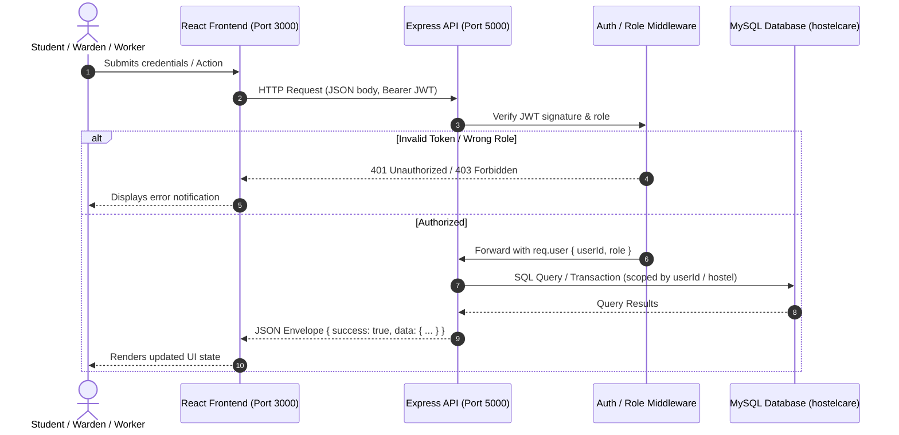

# HostelCare — Project Structure Documentation

This document describes the complete architecture, folder hierarchy, and module responsibilities of the **HostelCare** college DBMS project.

---

## 1. Project Root & Purpose

**HostelCare** is a student hostel complaint and maintenance resolution management system designed for a college DBMS course. It consists of two coordinated applications:
1. **Node.js + Express Backend:** A RESTful API server connected to MySQL, enforcing relational constraints, JWT authentication, and role-based access control.
2. **React + TypeScript + Vite Frontend:** An administrative and resident portal with dedicated dashboards for **Students**, **Wardens**, and **Maintenance Workers**.

Both applications reside in this workspace, organized as independent codebases:
```
c:\Users\thiru\OneDrive\Desktop\HostelCare Project\
├── database/                   # MySQL schema and seed data
├── docs/                       # Architectural and technical documentation
├── Frontend from Studio/       # React + TypeScript + Vite frontend application
├── runs/                       # Migration batch scripts
├── scripts/                    # Test, audit, and verification scripts
├── src/                        # Node.js + Express backend source code
├── .env.example                # Backend environment variable template
├── .gitignore                  # Git exclusion rules
├── package.json                # Backend dependency and script manifest
└── server.js                   # Backend HTTP server entry point
```

---

## 2. Backend Architecture (`HostelCare Project`)

The backend follows the standard **Model-View-Controller (MVC)** architectural pattern adapted for REST APIs: **Routes ➔ Controllers ➔ Services ➔ Database Pool**.

```
src/
├── config/
│   └── db.js                   # MySQL connection pool configuration (mysql2/promise)
├── controllers/
│   ├── authController.js       # HTTP handling for /api/auth (login, activate, me)
│   ├── complaintController.js  # HTTP handling for student /api/complaints
│   ├── healthController.js     # Health check handlers (/api/health, /api/health/db)
│   ├── studentComplaintController.js # HTTP handling for student close/reopen
│   ├── wardenComplaintController.js  # HTTP handling for /api/warden/complaints
│   └── workerComplaintController.js  # HTTP handling for /api/worker/complaints
├── middleware/
│   ├── authMiddleware.js       # JWT extraction and verification (req.user)
│   ├── errorHandler.js         # Centralized error handler returning clean JSON
│   ├── notFoundHandler.js      # Catch-all 404 handler for undefined routes
│   └── roleMiddleware.js       # Role authorization gate (authorize('ROLE'))
├── routes/
│   ├── authRoutes.js           # Auth route declarations mounted at /api/auth
│   ├── complaintRoutes.js      # Student complaint routes mounted at /api/complaints
│   ├── healthRoutes.js         # Health routes mounted at /api
│   ├── studentComplaintRoutes.js # Student close/reopen routes at /api/student/complaints
│   ├── wardenComplaintRoutes.js  # Warden routes at /api/warden/complaints
│   └── workerComplaintRoutes.js  # Worker routes at /api/worker/complaints
├── services/
│   ├── authService.js          # Authentication business logic, bcrypt, JWT signing
│   ├── complaintService.js     # Student complaint creation, retrieval, and status changes
│   ├── wardenComplaintService.js # Warden complaint queries, prioritization, worker assignment
│   └── workerComplaintService.js # Worker queue listing and status transitions
├── utils/
│   ├── apiError.js             # Custom operational error class (statusCode, message)
│   └── validation.js           # Syntactic input validators (email, string lengths)
└── app.js                      # Express application assembly, CORS, JSON body parser
```

### Module Responsibilities

- **`server.js`:** Loads `.env`, imports `app.js`, and binds the HTTP server to `process.env.PORT` (default: 5000). Kept separate from `app.js` to allow automated test tools to import the Express app without binding a network port.
- **`src/app.js`:** Express application initialization. Configures `cors()`, `express.json()`, mounts all route modules under `/api`, and registers `notFoundHandler` and `errorHandler`.
- **`src/config/db.js`:** Exports a `mysql2/promise` connection pool configured with environment credentials (`DB_HOST`, `DB_USER`, `DB_PASSWORD`, `DB_NAME`, `DB_PORT`).
- **`src/routes/`:** Lightweight routers that define HTTP endpoints and chain middleware (`authenticate`, `authorize(role)`). Business logic is never embedded in routes.
- **`src/controllers/`:** Validates request parameters and headers, catches validation errors, invokes the appropriate service function, and returns standardized JSON envelopes.
- **`src/services/`:** Core business logic and database transactions. All SQL queries and transactions run here. Enforces domain invariants (ownership by `userId`, same-hostel constraints, category matching).
- **`src/middleware/authMiddleware.js`:** Extracts `Authorization: Bearer <token>`, verifies the JWT using `JWT_SECRET`, and populates `req.user = { userId, role }`.
- **`src/middleware/roleMiddleware.js`:** Verifies that `req.user.role` matches the permitted role(s) for the endpoint. Returns `403 Access denied` on mismatch.
- **`src/middleware/errorHandler.js`:** Intercepts uncaught errors and `ApiError` instances. Logs technical errors server-side while returning clean error envelopes (`{ success: false, message: "..." }`) without exposing database details.

### Database Files (`database/`)

- **`database/schema.sql`:** DDL script creating all MySQL tables, primary keys, foreign keys, and indexes:
  - `hostels`: Hostel blocks (`BH-3`, `BH-4`, etc.)
  - `rooms`: Rooms per hostel (`A-101`, etc.)
  - `complaint_categories`: Predefined issue categories (`Electrical`, `Plumbing`, `Wi-Fi`, `Furniture`, `Cleaning`, `Water`, `Other`)
  - `users`: Core credentials table storing `user_id`, `email`, `password_hash`, `role`, and `is_active`
  - `students`: Student profile table linked to `users` and `rooms`
  - `wardens`: Warden profile table linked to `users` and `hostels`
  - `workers`: Worker profile table linked to `users`, `hostels`, and `complaint_categories`
  - `complaints`: Maintenance tickets with status (`PENDING`, `ASSIGNED`, `IN_PROGRESS`, `RESOLVED`, `CLOSED`) and priority
  - `assignments`: Worker assignments linked to complaints
  - `complaint_history`: Audit trail recording all status transitions
- **`database/seed.sql`:** Realistic development dataset inserting 5 hostels, 20 rooms, 7 categories, 35 user accounts (students, wardens, workers), sample complaints, and historical status updates.

### Test and Verification Scripts (`scripts/` and `runs/`)

- **`scripts/`:** Test harnesses and audit scripts for validating backend milestones:
  - `audit-4g-db.js`: Database integrity auditor
  - `test-phase4d.js` through `test-phase4g-lifecycle.js`: Phase-specific integration test scripts
  - `migrate-complaints-title.js`: Legacy title column migration script
- **`runs/migrate.bat`:** Windows batch file for executing database setup scripts.

---

## 3. Frontend Architecture (`Frontend from Studio/`)

The frontend is a modern single-page application built with **React 19**, **TypeScript**, and **Vite**.

```
Frontend from Studio/
├── assets/                     # Static UI assets and icons
├── src/
│   ├── components/
│   │   ├── auth/
│   │   │   ├── ActivationModal.tsx      # Student first-time room activation modal
│   │   │   └── LoginModal.tsx           # Multi-role sign-in modal with seeded demo fills
│   │   ├── common/
│   │   │   ├── BackendConfigModal.tsx   # Live API target URL configuration modal
│   │   │   ├── ComplaintTimeline.tsx    # Visual status history timeline
│   │   │   ├── Header.tsx               # Global navigation, health pill, user profile toggle
│   │   │   ├── PriorityBadge.tsx        # Styled priority pill (LOW, MEDIUM, HIGH, CRITICAL)
│   │   │   ├── ProfileModal.tsx         # User details and session inspector
│   │   │   ├── StatusBadge.tsx          # Styled status pill (PENDING, ASSIGNED, etc.)
│   │   │   └── Toast.tsx                # Floating status notifications
│   │   ├── student/
│   │   │   ├── RaiseComplaintModal.tsx  # Student complaint registration form
│   │   │   └── StudentDashboard.tsx     # Student complaint list, filters, close/reopen
│   │   ├── warden/
│   │   │   ├── WardenAnalytics.tsx      # Breakdown charts and resolution rate metrics
│   │   │   ├── WardenAssignModal.tsx    # Worker assignment dialog with specialty matching
│   │   │   ├── WardenDashboard.tsx      # Warden complaint review queue and filtering
│   │   │   ├── WardenDetailModal.tsx    # Comprehensive ticket review and priority update
│   │   │   └── WardenEscalateModal.tsx  # Informational facility escalation modal
│   │   └── worker/
│   │       └── WorkerDashboard.tsx      # Worker queue: view tasks, Start work, Mark resolved
│   ├── services/
│   │   └── api.ts              # Centralized API service for all HTTP communications
│   ├── types/
│   │   └── index.ts            # TypeScript interfaces matching backend models
│   ├── App.tsx                 # Root application component (state, session, role views)
│   ├── index.css               # Tailwind CSS styles and theme variables
│   └── main.tsx                # React DOM entry point (StrictMode mount)
├── index.html                  # HTML entry template
├── package.json                # Frontend dependencies and npm scripts
├── tsconfig.json               # TypeScript compiler configuration
└── vite.config.ts              # Vite server and build configuration
```

### Component Grouping by Role

1. **Student Components (`src/components/student/`):**
   - `StudentDashboard.tsx`: Displays tickets filed by the student, summary counts (Pending, In Progress, Resolved), search filters, and allows one-click **Confirm fix & close** or **Reopen**.
   - `RaiseComplaintModal.tsx`: Submits new complaints with category, title, description, and quick-fill presets.
2. **Warden Components (`src/components/warden/`):**
   - `WardenDashboard.tsx`: Review table of all hostel complaints with status, priority, and category filters. Offers CSV export.
   - `WardenAssignModal.tsx`: Assigns a pending complaint to a technician by numeric worker ID.
   - `WardenDetailModal.tsx`: Displays ticket details and enables in-place priority modifications.
   - `WardenAnalytics.tsx`: Calculates resolution rates, category distributions, and urgency counts.
3. **Worker Components (`src/components/worker/`):**
   - `WorkerDashboard.tsx`: Displays assigned tasks fetched from `GET /api/worker/complaints`. Features **Start** (`IN_PROGRESS`) and **Resolve** (`RESOLVED`) actions, note inputs, manual lookup, and refresh button.
4. **Authentication & Session (`src/components/auth/` & `src/components/common/`):**
   - `LoginModal.tsx`: Email/password form with quick-fill presets for seeded Warden and Worker accounts.
   - `ActivationModal.tsx`: Five-field room account activation form (email, hostel, room, activation key, password).
   - `BackendConfigModal.tsx`: Live API URL tester checking `/api/health` and `/api/health/db`.

---

## 4. Environment Configuration

### Backend: `.env` (Template: `.env.example`)

The backend consumes environment variables through the `dotenv` package in `src/app.js` and `server.js`.

| Variable Name | Required | Default / Example | Purpose |
| :--- | :---: | :--- | :--- |
| `PORT` | No | `5000` | Port on which Express listens for incoming HTTP requests. |
| `DB_HOST` | Yes | `localhost` | Hostname or IP of the MySQL server. |
| `DB_PORT` | No | `3306` | Port of the MySQL server. |
| `DB_USER` | Yes | `root` | Database username. |
| `DB_PASSWORD` | Yes | *(empty)* | Database user password. |
| `DB_NAME` | Yes | `hostelcare` | Target database name containing `schema.sql`. |
| `HOSTEL_ACTIVATION_KEY`| Yes | `HOSTELCARE2026` | Master activation key validated during student activation. |
| `JWT_SECRET` | Yes | *(random string)* | Cryptographic secret for signing and verifying JWT tokens. |
| `JWT_EXPIRES_IN` | No | `1h` | Token expiration duration (e.g., `1h`, `24h`). |

### Frontend: `.env.example`

The frontend reads configuration via Vite's `import.meta.env`.

| Variable Name | Required | Default | Purpose |
| :--- | :---: | :--- | :--- |
| `VITE_API_BASE_URL` | No | `http://localhost:5000/api` | Base URL of the backend API server. |

### API URL Resolution Flow

The frontend resolves its backend target using the following priority order (`api.ts#resolveApiBase`):
1. **User Override (`localStorage`):** Configured via the in-app **Backend Settings** modal (`hostelcare_api_url`).
2. **Environment Variable:** `VITE_API_BASE_URL` defined in `.env`.
3. **Default Fallback:** `http://localhost:5000/api`.

---

## 5. Root Configuration Files

- **`package.json` (Backend):** Declares backend dependencies (`express`, `mysql2`, `bcrypt`, `jsonwebtoken`, `cors`, `dotenv`) and start scripts (`start`, `dev`).
- **`package-lock.json`:** Exact dependency resolution tree for reproducible backend builds.
- **`.gitignore`:** Ignores `node_modules/`, `.env`, temporary editor files, and build artifacts.
- **`Frontend from Studio/package.json`:** Declares frontend dependencies (`react`, `react-dom`, `lucide-react`, `motion`, `@tailwindcss/vite`) and scripts (`dev`, `build`, `lint`).
- **`Frontend from Studio/vite.config.ts`:** Vite configuration with Tailwind CSS plugin and port 3000 settings.
- **`Frontend from Studio/tsconfig.json`:** TypeScript compiler settings targeting ES2022 with DOM libraries.

---

## 6. Excluded & Generated Directories (Do Not Commit)

- **`node_modules/`:** Installed npm package dependencies in both backend and frontend.
- **`.env`:** Local environment variables containing private database credentials and keys.
- **`dist/` or `build/`:** Production build output folders generated by Vite.
- **`.DS_Store`, `Thumbs.db`:** Operating system metadata files.

---

## 7. How to Extend the Application

| What to Add | Where to Place Files | Pattern to Follow |
| :--- | :--- | :--- |
| **New API Route** | `src/routes/<resource>Routes.js` | Mount in `src/app.js` with `authenticate` & `authorize(role)` |
| **New HTTP Controller**| `src/controllers/<resource>Controller.js` | Validate params, call service, return `{ success: true, data }` |
| **New Business Service**| `src/services/<resource>Service.js` | Query `pool`, handle transactions, throw `ApiError` |
| **New Middleware** | `src/middleware/<name>.js` | Express middleware signature `(req, res, next)` |
| **New Frontend Component**| `Frontend from Studio/src/components/<role>/` | Functional React component with Tailwind styling |
| **New API Method** | `Frontend from Studio/src/services/api.ts` | Method calling `handleResponse()` with `getAuthHeaders()` |
| **New Type Definition**| `Frontend from Studio/src/types/index.ts` | TypeScript interface or union type |
| **New Integration Test**| `scripts/test-<feature>.js` | Standalone script using `fetch` or MySQL queries |

---

## 8. Frontend ⟷ Backend Communication Architecture



All communication between the frontend and backend follows these strict rules:
1. **JSON Over HTTP:** Every request body and response payload uses `application/json`.
2. **Stateless JWT Authorization:** Tokens are passed via the standard `Authorization: Bearer <token>` header.
3. **Standard Envelopes:**
   - Success: `{ "success": true, "message"?: "...", "data": { ... } }`
   - Failure: `{ "success": false, "message": "..." }`
4. **CORS Enabled:** The backend Express app enables cross-origin resource sharing for all requests.

